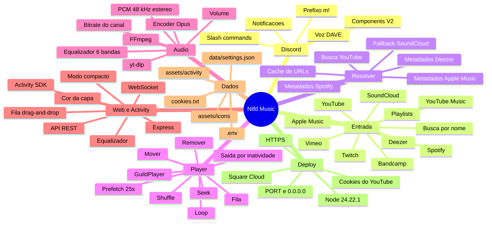
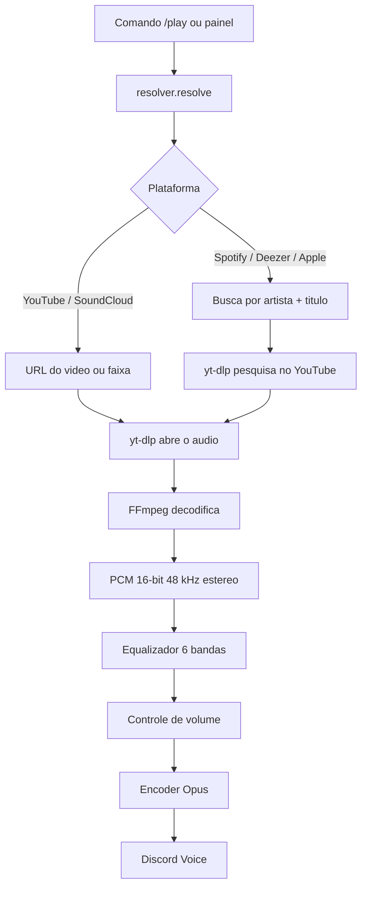
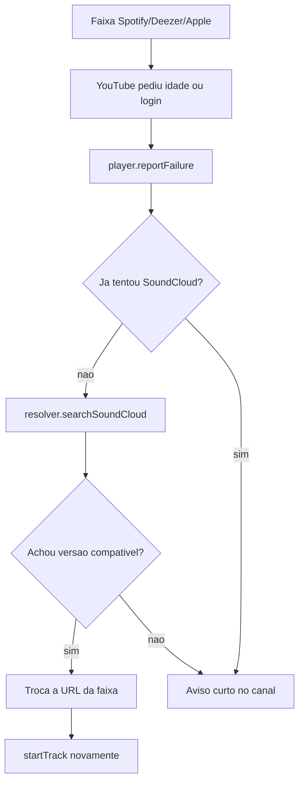
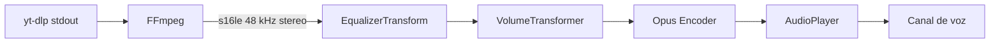
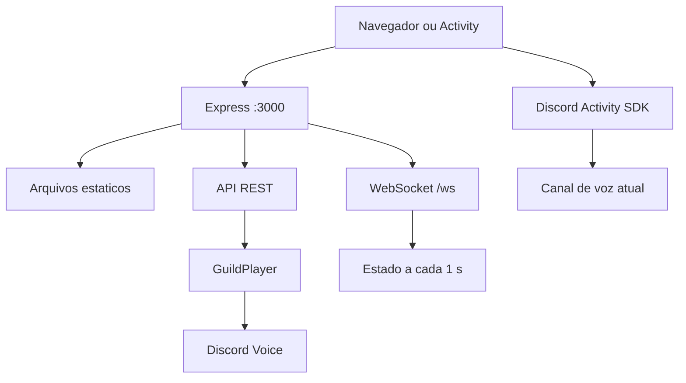

# Mapa mental — Ntfd Music

> Documento de arquitetura e operação do bot, do comando `/play` até a Activity.
> Estado atual: **v36**, Node **22.12+**, equalizador gráfico de 6 bandas.

---

## 1. Visão geral (mind map)



---

## 2. Fluxo de reproducao



### Caminho de falha e fallback



---

## 3. Estrutura de arquivos

```text
src/
├─ index.js              Entrada, cliente Discord e runtime
├─ config.js             .env, portas, cookies e limites
├─ events.js             Eventos e registro dos comandos
├─ commands.js           Slash commands e prefixo
├─ context.js            Contexto dos comandos
├─ player.js             GuildPlayer, fila, prefetch, seek e voz
├─ audio.js              yt-dlp -> FFmpeg -> EQ -> volume -> Opus
├─ equalizer.js          Biquads e presets do equalizador
├─ playback-cache.js     Pre-aquecimento do primeiro resultado
├─ resolver.js           YouTube, playlists, busca e SoundCloud
├─ ytdlp.js              Binario, cookies, URLs diretas e cache
├─ spotify.js            Metadados do Spotify
├─ deezer.js             Metadados do Deezer
├─ applemusic.js         Metadados do Apple Music
├─ ui.js                 Componentes V2 e avisos
├─ emojis.js             Icones de plataformas e controles
├─ settings.js           Preferencias em data/settings.json
└─ web/
   ├─ server.js          Express, API, WebSocket e Activity
   └─ public/
      ├─ index.html      Player / Activity
      ├─ app.js          Busca, fila, drag-and-drop e EQ
      ├─ app.css         Tema, layout e modo compacto
      └─ *.png           Artes e icones do painel
```

| Arquivo | Responsabilidade |
|---|---|
| `src/player.js` | Estado da call, fila, prefetch, seek, loop e troca de faixa |
| `src/audio.js` | Pipeline de audio e ciclo de vida dos processos |
| `src/equalizer.js` | Filtros biquad por banda e presets |
| `src/resolver.js` | Deteccao de plataforma, playlists e busca |
| `src/ytdlp.js` | Execucao do yt-dlp, cookies e cache de URL direta |
| `src/web/server.js` | API REST, WebSocket, autenticacao opcional e capas |
| `src/web/public/app.js` | Interface: fila, busca, tempo e equalizador |
| `src/settings.js` | Persistencia do equalizador entre reinicios |

---

## 4. Player e fila

### GuildPlayer

- Uma instancia por servidor, guardada em `players` (`guildId -> GuildPlayer`).
- Entra no canal com `joinVoiceChannel` e usa o bitrate do canal.
- `NoSubscriberBehavior.Pause` evita tocar sozinho sem ninguem na call.
- Sai automaticamente depois de **5 minutos** sem musica ou sem ouvintes.

### Fila

| Operacao | Onde |
|---|---|
| Adicionar | `enqueue()` / `play` / `playnext` |
| Remover | `/remove`, lixeira do painel |
| Mover | `move(from, to)` e drag-and-drop |
| Limpar | `/clear` e `stop()` |
| Embaralhar | `shuffle()` |
| Pular | `skip()` e `jump(index)` |
| Repetir | `loop = off / track / queue` |

### Prefetch e seek

- Nos ultimos **~25 s** da faixa atual, `tick()` abre a proxima em segundo plano.
- O cache de playback guarda o primeiro resultado da busca por ate 90 s.
- `seek()` tenta a URL direta do yt-dlp com FFmpeg; se falhar, usa o caminho normal por secao.
- A barra de tempo do painel interpola a posicao entre pacotes do WebSocket.

---

## 5. Pipeline de audio



### Equalizador

- 6 bandas: `60`, `150`, `400`, `1000`, `2400`, `15000` Hz.
- Cada banda e um filtro **peaking biquad** com Q ajustado.
- O filtro roda em JavaScript no PCM, antes do encoder Opus.
- Mudanca de ganho e aplicada no proximo bloco de audio, **sem reiniciar a musica**.
- Estado:

```json
{
  "enabled": true,
  "preset": "muffled",
  "gains": [6, 6, 4, -6, -10, -12]
}
```

- Presets: `flat`, `muffled`, `bass`, `vocal`, `treble`.
- `manual` guarda a curva arrastada pelo usuario.
- Persistencia: `data/settings.json` (ignorado pelo Git).
- Bypass: quando `enabled=false`, os ganhos efetivos sao todos zero.

### Volume e bitrate

- O volume usa `prism.VolumeTransformer` (0-100).
- O bitrate do encoder acompanha o bitrate do canal, limitado a 384 kbps.

---

## 6. Painel web e Activity



### Rotas principais

| Rota | Metodo | Uso |
|---|---|---|
| `/api/state` | GET | Estado completo do player |
| `/api/search` | GET | Busca opcoes ou resolve um link |
| `/api/play` | POST | Toca uma faixa ou playlist |
| `/api/join` | POST | Entra no canal de voz |
| `/api/leave` | POST | Sai do canal |
| `/api/pause` / `/api/resume` | POST | Pausa / retoma |
| `/api/skip` / `/api/stop` | POST | Pula / para |
| `/api/seek` | POST | Vai para um segundo |
| `/api/volume` | POST | Muda o volume |
| `/api/eq` | POST | Aplica o equalizador |
| `/api/loop` / `/api/shuffle` | POST | Repeticao / embaralhar |
| `/api/remove` / `/api/move` | POST | Remove / reordena a fila |
| `/api/cover` | GET | Proxy de capas permitidas |
| `/ws` | WebSocket | Estado em tempo real |

### Autenticacao

- `WEB_TOKEN` vazio: painel aberto (uso local/Activity).
- `WEB_TOKEN` definido: exige `x-ntfd-token` ou `?token=`.
- O Activity SDK e carregado de `/sdk/index.mjs` (pacote `@discord/embedded-app-sdk`).

---

## 7. Comandos e notificacoes

- Slash commands e prefixo `m!`.
- `help` lista os comandos.
- Avisos de "tocando agora" usam Components V2 e botoes de controle.
- Falhas e desconexao vao para o canal fixo `WEB_TEXT_CHANNEL_ID` quando configurado.
- A fila e os paineis sao limpos ao sair da call.

---

## 8. Configuracao e persistencia

| Dado | Local | Vai para o Git? |
|---|---|---|
| Token do bot | `.env` | Nunca |
| Cookies do YouTube | `cookies.txt` | Nunca |
| Equalizador | `data/settings.json` | Nunca |
| Icones e artes | `assets/` | Sim |
| Codigo | `src/` | Sim |
| Dependencias | `node_modules/` | Nunca |
| yt-dlp | `bin/` | Nunca |

---

## 9. Deploy

### Requisitos

- Node **22.12+** por causa da voz DAVE.
- FFmpeg via `ffmpeg-static`.
- yt-dlp Linux baixado no primeiro start.
- Porta e host definidos pelo provedor.

### Square Cloud (exemplo)

```text
MAIN=src/index.js
MEMORY=1024
VERSION=recommended
SUBDOMAIN=ntfd-music
```

```env
DISCORD_TOKEN=...
WEB_HOST=0.0.0.0
WEB_PORT=3000
WEB_PUBLIC_URL=https://ntfd-music.squareweb.app
```

- `VERSION=recommended` usa Node **24.22.1**.
- `VERSION=latest` usa Node **26.12.1**.
- Confirme a versao nos logs: `Runtime Node v24.22.1`.
- Atualize o URL Mapping `/` da Activity para o dominio gerado.

### Túnel local

```bash
cloudflared tunnel --url http://127.0.0.1:3000
```

- Use o host gerado no URL Mapping, sem `https://`.
- Nao marque **Application URL Override** quando estiver usando URL Mapping.

---

## 10. Seguranca

- Nunca versione `.env`, `cookies.txt`, `data/` ou logs.
- Se um token aparecer em print, arquivo ou commit, resete no Developer Portal.
- Use `WEB_TOKEN` se o painel ficar publico sem a Activity.
- O proxy de capas so aceita hosts de Spotify, YouTube, Deezer, Discord e SoundCloud.
- O bot precisa das intencoes `Guilds` e `GuildVoiceStates`; `MessageContent` e opcional.
- A voz do Discord usa DAVE; Node antigo pode falhar ao conectar.

---

## 11. Limitacoes conhecidas

- Musicas com restricao de idade podem exigir cookies de uma conta secundaria.
- IPs de datacenter podem receber bloqueio/403 do YouTube; cookies ajudam.
- O seek reabre o audio a partir do ponto escolhido e pode levar alguns segundos.
- O prefetch depende do yt-dlp responder a tempo; a primeira troca manual pode demorar.
- A Activity depende de HTTPS e de um URL Mapping correto.
- O equalizador consome CPU proporcional ao numero de ouvintes/faixas; 6 bandas em 48 kHz e leve.

---

## 12. Estado atual

- Versao do painel: **v36**.
- Equalizador grafico de 6 bandas com drag-and-drop, presets e persistencia.
- Fila com arrastar e soltar e lixeira.
- Busca com opcoes, playlists inteiras e fallback SoundCloud.
- Painel sem token por padrao, com modo compacto para Activity.
- Notificacoes em Components V2.
- Deploy preparado para Node 24.22.1 e `PORT`/`0.0.0.0`.
