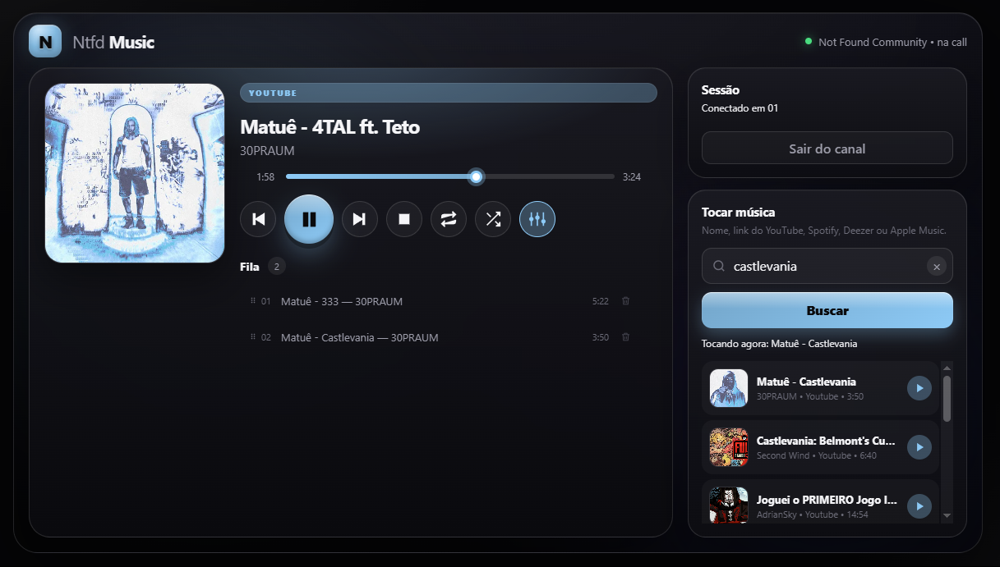
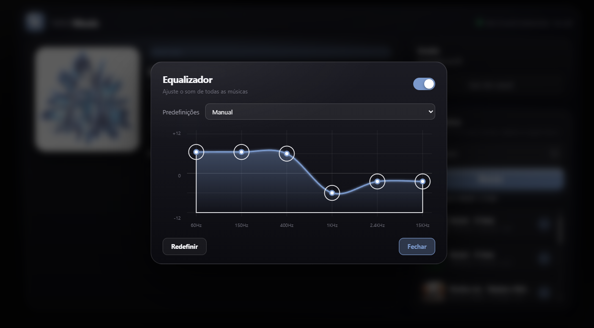
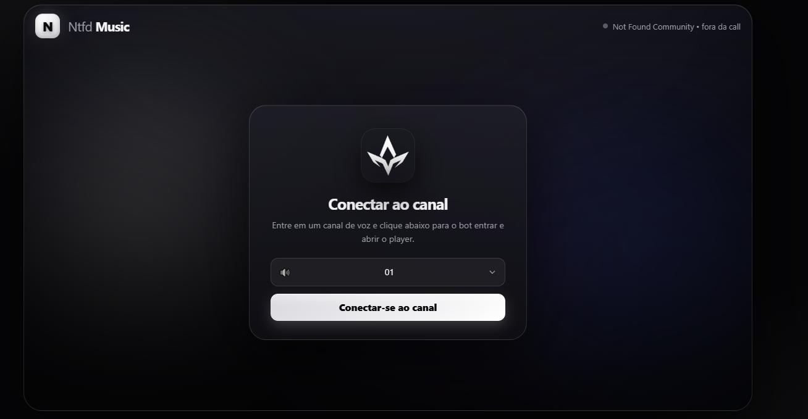
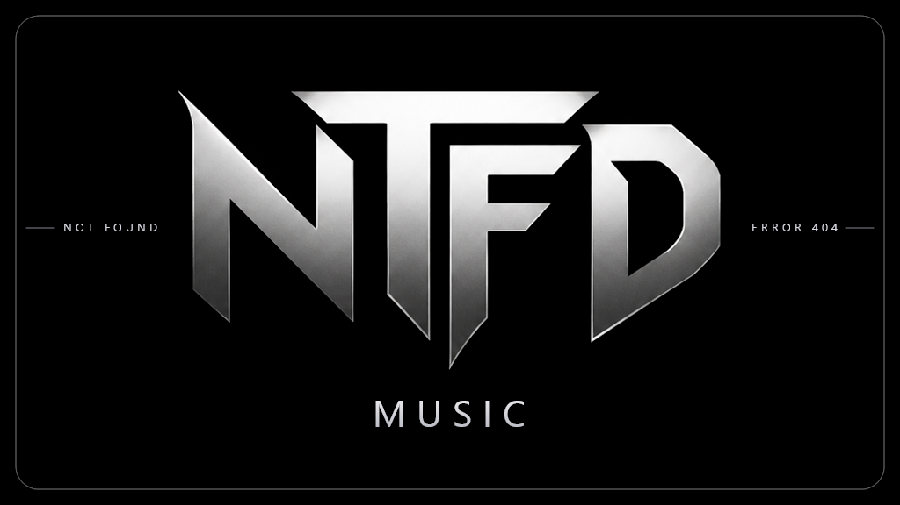

# Ntfd Music

> Bot de música para Discord com painel web/Activity, fila arrastável, playlists e equalizador gráfico de 6 bandas.

O Ntfd Music toca YouTube, YouTube Music, Spotify, Deezer, Apple Music, SoundCloud e outros links suportados pelo `yt-dlp`. O controle principal fica em um painel web que também abre como Activity dentro do Discord.

> **Pacote:** o código-fonte está em `Ntfd-Music.rar`, protegido por senha (RAR5/AES-256, com cabeçalhos criptografados). Extraia antes de rodar. O hash do arquivo está em `SHA256SUMS.txt`.

---

## Preview

| Painel web / Activity | Equalizador |
|---|---|
|  |  |

| Conexão ao canal | Activity |
|---|---|
|  |  |

---

## Status

| Item | Valor |
|---|---|
| Runtime | Node.js **22.12+** (necessário para a voz DAVE do Discord) |
| Biblioteca | discord.js 14 + @discordjs/voice |
| Áudio | FFmpeg (PCM 48 kHz) + encoder Opus |
| Extração | yt-dlp (download automático na primeira execução) |
| Painel | Express + WebSocket + Activity SDK |
| Licença | Proprietária — todos os direitos reservados |

---

## Recursos

### Reprodução
- YouTube, YouTube Music, SoundCloud, Bandcamp, Twitch, Vimeo e outros sites suportados pelo `yt-dlp`.
- Spotify, Deezer e Apple Music por metadados: o áudio é buscado no YouTube.
- Playlists inteiras, com limite configurável de faixas.
- Busca por nome com lista de opções antes de tocar.
- Fallback automático para o SoundCloud quando o YouTube pede idade/login em uma faixa de outra plataforma.

### Fila e player
- Fila com adicionar, remover, limpar, embaralhar e pular.
- Reordenação por **arrastar e soltar** no painel.
- Repetir música ou fila.
- Seek, avançar e voltar.
- Pré-carregamento da próxima faixa nos últimos ~25 segundos.
- Saída automática da call após 5 minutos sem uso.
- Notificações de "tocando agora", falhas e desconexão em Components V2.

### Painel web / Activity
- Abre sem pedir token por padrão.
- Seletor de canal de voz.
- Capa, título, artista, plataforma, tempo e barra de progresso.
- Busca com resultados clicáveis e playlists.
- Fila com lixeira e reordenação por arrastar.
- Cor do tema puxada da capa da música.
- Modo compacto para a Activity minimizada.
- Equalizador gráfico de 6 bandas.

### Equalizador
- Bandas: **60 Hz, 150 Hz, 400 Hz, 1 kHz, 2,4 kHz e 15 kHz**.
- Pontos arrastáveis, de -12 dB a +12 dB.
- Predefinições: Normal, Abafado, Grave, Vocal e Agudo.
- Liga/desliga sem perder a curva.
- Botão **Redefinir**.
- Filtro aplicado **ao vivo** no PCM, antes do Opus: não reinicia a música.
- Vale para todas as fontes e é salvo em `data/settings.json`.

---

## Stack

- **Node.js 22.12+**
- **discord.js 14** e **@discordjs/voice**
- **yt-dlp** para extração de áudio
- **FFmpeg** para decodificar e converter para PCM 48 kHz
- **prism-media** para volume e encoder Opus
- **Express** + **ws** para o painel
- **@discord/embedded-app-sdk** para a Activity
- **libsodium-wrappers** para a criptografia de voz do Discord

---

## Estrutura do projeto

```text
Ntfd Music/
├─ src/
│  ├─ index.js              Entrada do bot e cliente Discord
│  ├─ config.js             Leitura do .env e configurações
│  ├─ events.js             Eventos, registro de comandos e boas-vindas
│  ├─ commands.js           Slash commands e comandos com prefixo
│  ├─ context.js            Contexto compartilhado dos comandos
│  ├─ player.js             GuildPlayer: fila, prefetch, seek, loop e conexão
│  ├─ audio.js              Pipeline yt-dlp -> FFmpeg -> EQ -> Opus
│  ├─ equalizer.js          Equalizador de 6 bandas em biquads
│  ├─ playback-cache.js     Pré-aquecimento do primeiro resultado
│  ├─ resolver.js           YouTube, playlists, busca e fallback SoundCloud
│  ├─ ytdlp.js              Download, cookies, URLs diretas e cache
│  ├─ spotify.js            Metadados do Spotify
│  ├─ deezer.js             Metadados do Deezer
│  ├─ applemusic.js         Metadados do Apple Music
│  ├─ ui.js                 Painéis e avisos em Components V2
│  ├─ emojis.js             Ícones das plataformas e botões
│  ├─ settings.js           Preferências persistidas (equalizador)
│  └─ web/
│     ├─ server.js          API, WebSocket, arquivos estáticos e Activity
│     └─ public/
│        ├─ index.html      Player / Activity
│        ├─ app.js          Fila, drag-and-drop, busca e equalizador
│        ├─ app.css         Tema preto/branco e modo compacto
│        └─ *.png           Ícones e artes do painel
├─ assets/
│  ├─ icons/                Ícones enviados como emojis do app
│  └─ activity/             Fundo, capa e preview da Activity
├─ .env.example
├─ package.json
└─ README.md
```

O mapa mental completo está em [`MapaMentalNtfd.md`](MapaMentalNtfd.md).

---

## Requisitos

- Node.js **22.12 ou mais novo** (a voz criptografada do Discord/DAVE exige essa versão).
- FFmpeg: o projeto instala `ffmpeg-static` pelo npm.
- yt-dlp: baixado automaticamente na primeira execução, ou defina `YTDLP_PATH`.
- Um aplicativo no Discord Developer Portal com bot e Activity.

---

## Instalação

### A partir do pacote

1. Extraia `Ntfd-Music.rar` com a senha fornecida pelo autor.
2. Entre na pasta `Ntfd-Music-Source`.
3. Instale as dependências e configure o `.env`:

```bash
cd Ntfd-Music-Source
npm install
copy .env.example .env    # Windows
# cp .env.example .env    # Linux/macOS
```

Preencha o `.env` e rode:

```bash
npm start
```

Se aparecer erro de dependências:

```bash
npm install --legacy-peer-deps
```

O projeto já inclui `.npmrc` com `legacy-peer-deps=true` para evitar esse problema.

---

## Configuração do `.env`

| Variável | Obrigatória | Descrição |
|---|---|---|
| `DISCORD_TOKEN` | Sim | Token do bot (Developer Portal -> Bot -> Reset Token) |
| `PREFIX` | Não | Prefixo dos comandos de texto (padrão `m!`) |
| `ENABLE_MESSAGE_CONTENT` | Não | `true` para comandos com prefixo; exige a intent no portal |
| `DEV_GUILD_ID` | Não | Registra os slash commands na hora nesse servidor |
| `WEB_HOST` | Não | `127.0.0.1` local; `0.0.0.0` em hospedagem |
| `WEB_PORT` | Não | Porta do painel (padrão `3000`) |
| `PORT` | Não | Se o provedor definir, tem prioridade sobre `WEB_PORT` |
| `WEB_TOKEN` | Não | Chave opcional para proteger o painel exposto |
| `WEB_PUBLIC_URL` | Não | URL pública usada pelo comando `/start` |
| `WEB_GUILD_ID` | Não | Fixa o servidor usado pelo painel |
| `WEB_TEXT_CHANNEL_ID` | Não | Canal fixo dos avisos |
| `DEFAULT_VOLUME` | Não | Volume inicial de 1 a 100 (padrão 80) |
| `MAX_PLAYLIST_TRACKS` | Não | Limite de faixas por playlist (padrão 100) |
| `YTDLP_PATH` | Não | Caminho de um yt-dlp já instalado |
| `YTDLP_COOKIES` | Não | Arquivo `cookies.txt` para músicas com restrição de idade |
| `YTDLP_COOKIES_FROM_BROWSER` | Não | `chrome`, `edge`, `firefox`, `brave`, `opera` ou `vivaldi` |
| `YTDLP_EXTRA_ARGS` | Não | Argumentos extras do yt-dlp |

> Nunca envie o `.env`, `cookies.txt` ou `data/settings.json` para o GitHub.

---

## Comandos

Funcionam com prefixo `m!` e como slash commands `/`.

| Comando | O que faz |
|---|---|
| `play <link ou nome>` (`p`) | Toca ou enfileira. Sem argumento, retoma se estiver pausado |
| `playnext` (`pn`) | Coloca no começo da fila |
| `pause` / `resume` | Pausa / retoma |
| `skip` (`s`, `n`) | Pula |
| `skipto <posição>` (`jump`) | Vai direto para a posição da fila |
| `seek <tempo>` (`goto`) | Vai para um momento: `1:30`, `90`, `+30`, `-15` |
| `forward [seg]` (`ff`) / `rewind [seg]` (`back`) | Avança / volta (padrão 10 s) |
| `queue [página]` (`q`) | Lista a fila com menu de seleção |
| `nowplaying` (`np`) | Painel da música atual |
| `volume [1-100]` | Mostra ou muda o volume |
| `loop [off/track/queue]` | Repete música ou fila |
| `shuffle` / `remove <pos>` / `clear` | Embaralha / remove uma / limpa a fila |
| `stop` / `leave` | Para e limpa / sai do canal |
| `start` | Envia o link do painel/Activity |
| `help` | Lista os comandos |

---

## Painel e Activity

### Rodando localmente

```bash
npm start
```

Abra `http://127.0.0.1:3000`.

Para testar a Activity fora do Discord, use um túnel HTTPS:

```bash
cloudflared tunnel --url http://127.0.0.1:3000
```

### Configurando a Activity

1. No Developer Portal, abra **Activities** e ative a Activity.
2. Em **URL Mappings**, crie:
   - **Prefix:** `/`
   - **Target:** o host do túnel ou da hospedagem, **sem `https://` e sem barra no final**.
3. Em **Activity Assets**, envie:
   - `assets/activity/activity-background-final.png`
   - `assets/activity/activity-cover-final.png`
   - `assets/activity/activity-preview-final.mp4`
4. O `DISCORD_CLIENT_ID` usado pela Activity está em `src/web/public/app.js`. Troque se estiver usando outro aplicativo.
5. Não use **Application URL Override** quando estiver com túnel + URL Mapping.

Se a Activity abrir branca, o túnel provavelmente caiu ou o URL Mapping está apontando para um endereço antigo. Se abrir preta com o override marcado, desmarque o override.

---

## Deploy

O projeto precisa de **Node 22.12+**. Na Square Cloud, o runtime `recommended` usa Node **24.22.1**; o `latest` usa 26.12.1.

Configuração típica:

```text
MAIN=src/index.js
MEMORY=1024
VERSION=recommended
SUBDOMAIN=ntfd-music
```

Variáveis de ambiente mínimas:

```env
DISCORD_TOKEN=...
WEB_HOST=0.0.0.0
WEB_PORT=3000
WEB_PUBLIC_URL=https://ntfd-music.squareweb.app
# WEB_TOKEN=...            (opcional)
# WEB_TEXT_CHANNEL_ID=...  (opcional)
```

Passos:

1. Gere um ZIP sem `node_modules`, `bin`, `.env`, cookies e logs.
2. Suba o ZIP na hospedagem.
3. Configure as variáveis no painel.
4. Confirme nos logs uma linha parecida com `Runtime Node v24.22.1`.
5. Atualize o URL Mapping da Activity para o domínio gerado.

O `ffmpeg-static` é instalado pelo npm. O `yt-dlp` é baixado no primeiro start; em produção, mantenha a pasta `bin/` gravável ou defina `YTDLP_PATH`.

---

## Segurança

- Mantenha `.env`, `cookies.txt`, `data/` e logs fora do Git.
- Se um token for exposto, resete imediatamente no Developer Portal.
- Use `WEB_TOKEN` se o painel ficar exposto na internet sem a Activity.
- O painel só busca capas de hosts permitidos (Spotify, YouTube, Deezer, Discord e SoundCloud).
- A Activity usa o SDK oficial do Discord e não precisa de token no navegador.
- Músicas com restrição de idade podem exigir cookies de uma conta secundária.

---

## Problemas comuns

| Problema | Solução |
|---|---|
| `DISCORD_TOKEN não definido` | Copie `.env.example` para `.env` e preencha |
| `Used disallowed intents` | Ligue a intent de conteúdo ou use `ENABLE_MESSAGE_CONTENT=false` |
| `HTTP Error 403` no YouTube | Reinicie para atualizar o yt-dlp; se persistir, use cookies |
| "O YouTube pediu login" | Configure `YTDLP_COOKIES` ou `YTDLP_COOKIES_FROM_BROWSER` |
| Sem áudio | Rode `npm run doctor` e `npm rebuild ffmpeg-static` |
| Activity branca | Confira o túnel e o URL Mapping `/` |
| Activity preta com override | Desmarque **Application URL Override** |
| Voz não conecta | Confirme Node 22.12+ e as permissões de conectar/falar |

---

## Licença

Proprietária — **todos os direitos reservados**. O código, a documentação e os assets não podem ser usados, copiados, modificados ou redistribuídos sem autorização por escrito. Veja [`LICENSE`](LICENSE).

As dependências de terceiros mantêm suas próprias licenças.

---

## Documentação

- [`MapaMentalNtfd.md`](MapaMentalNtfd.md) — arquitetura, fluxos e mapa mental.
- [`SECURITY.md`](SECURITY.md) — segredos, painel exposto e versões.
